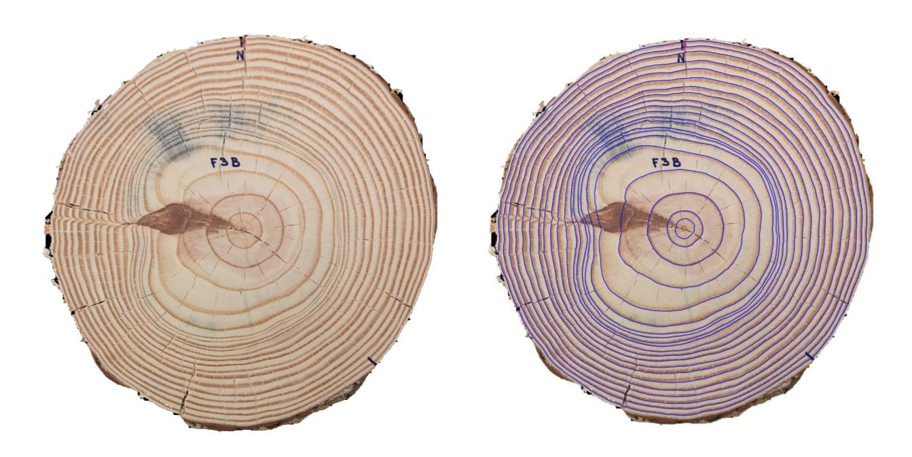

# CS-TRD: a Cross Sections Tree Ring Detection method

**Accepted at Image Processing On Line (IPOL) 2025**.

Repository for the paper "CS-TRD: a Cross Sections Tree Ring Detection method". 


Demo: [DEMO][link_ipol_paper].

UruDendro ImageSet: [UruDendro][link_urudendro].
ArXiv paper: [ArXiv][link_arxiv_paper].

***


[link_ipol_paper]: https://www.ipol.im/pub/pre/485/
[link_urudendro]: https://rdcu.be/euo3F
[link_arxiv_paper]: https://doi.org/10.48550/arXiv.2305.10809
***



***
Version 1.0
Last update: 23/05/2025

Authors: 
-	Henry Marichal, henry.marichal@fing.edu.uy
-   Diego Passarella, diego.passarella@cut.edu.uy
-   Gregory Randall, randall@fing.edu.uy

## Get started

#### 1. Folders
All the python source files are in lib/ folder. Dependencies are in externas/ folder. 
Default configuration files are in config/ folder. 


#### Paper    
Algorithm 1 is implemented in the file **main.py**

Line 1 of Algorithm 1 is implemented in file **lib/preprocessing.py**

Canny-Devernay implementation [[10](https://www.ipol.im/pub/art/2017/216/)] is in **externas/devernay_1.0**. Python
wrapper is in **lib/canny_devernay_edge_detector.py**

Line 3 of Algorithm 1 is implemented in the file **lib/filter_edges.py**

Algorithm 2 is implemented in the file **lib/sampling.py**


Algorithm 3, 4, 5 are implemented in the file **lib/merge_chains.py**

Algorithm 6 is implemented in the file **lib/basic_properties.py**

Algorithm 7 is implemented in the file **lib/postprocessing.py**

## Installation
### Setup environment
#### Conda
```bash
conda create --name ipol python==3.11
conda activate ipol
conda install -n ipol -c conda-forge geos
conda install -n ipol -c anaconda cmake 
conda install -n ipol pip
```
#### APT 
```bash 
sudo apt-get update && sudo apt-get install -y libgeos-dev=3.8.0-1build1 cmake=3.16.3-1ubuntu1.20.04.1
```
### Install the package
```bash
python setup.py install
pip install -r requirements.txt
```

## Examples of usage
### Import the module
```python
from cross_section_tree_ring_detection.cross_section_tree_ring_detection import TreeRingDetection
from cross_section_tree_ring_detection.io import load_image

args =  dict(cy=1264, cx=1204, sigma=3, th_low=5, th_high=20,
        height=1500, width=1500, alpha=30, nr=360,
        mc=2)

im_in = load_image('input/F02c.png')
res = TreeRingDetection(im_in, **args)

rings_point = res[-1]

```
### CLI
```bash
python main.py --input input/F02c.png --cy 1264 --cx 1204  --output_dir ./output --root ./
```
If you want to run the algorithm generating intermediate results you can use the flag --save_imgs

```bash
python main.py --input input/F02c.png --cy 1264 --cx 1204  --output_dir ./output --root ./ --save_imgs 1
```

## Automatic center detection
Detecting pith center automatically can be done using software from IPOL paper "Ant Colony Optimization for Estimating Pith Position on Images of Tree Log Ends" [IPOL][link_ipol_pith_paper].

[link_ipol_pith_paper]: https://www.ipol.im/pub/art/2022/338/?utm_source=doi

## Automatic background removal
Install repository [uruDendro](https://github.com/hmarichal93/uruDendro). Then,
```python
from urudendro.remove_salient_object import remove_salient_object
IMAGE_PATH = 'input/F02c.jpg'
OUTPUT_PATH = 'input/F02c_segmented.jpg'
remove_salient_object(IMAGE_PATH, OUTPUT_PATH)
```

## Metric Computation
Install repository [uruDendro](https://github.com/hmarichal93/uruDendro). Then,
Tree ring Detection evaluation metrics used by UruDendro. The evaluation code provided here can be used to obtain results on the publicly available UruDendro dataset. It computes multiple metrics described below.
```python 
from urudendro.metric_influence_area import main as metric
    
DETECTION_FILENAME = 'path/to/detection/file'
GROUND_TRUTH_FILENAME = 'path/to/ground/truth/file'
IMAGE_FILENAME = 'path/to/image/file'
CX = 0
CY = 0
THRESHOLD = 0.5
OUTPUT_DIR = 'path/to/output/directory'

P, R, F, RMSE, TP, FP, TN, FN = metric(DETECTION_FILENAME, GROUND_TRUTH_FILENAME, IMAGE_FILENAME, CX, CY, THRESHOLD, OUTPUT_DIR)

```
where DETECTION_FILENAME is the path to the detection file, GROUND_TRUTH_FILENAME is the path to the ground truth file,
IMAGE_FILENAME is the path to the image file, CX is the x pith coordinate in pixels, CY is the y pith coordinate in pixel, 
THRESHOLD is the threshold to consider a detection as valid (between 0 and 1) and OUTPUT_DIR is the path to the 
results output directory.

## Docker Container
You can run the algorithm in a docker container.

### Pull the image
```bash
docker pull hmarichal/cstrd:v1.0
```

### Run the container
In order to run the container you need to mount a volume with the data you want to process (YOUR_DATA_FOLDER). Results 
will be stored in the mounted volume. Run the following command:
```bash
docker run -v YOUR_DATA_FOLDER:/workdir/bin/output -it hmarichal/cstrd:v1.0 / 
 python main.py --input YOUR_DATA_FOLDER/image_path --cy 1264 --cx 1204 /
 --output_dir ./output --root ./ --save_imgs 1
```

### Build the image
```bash
 docker build -f .ipol/Dockerfile . -t hmarichal/cstrd:v1.0
```

## Citation
```
@misc{marichal2023cstrd,
      title={CS-TRD: a Cross Sections Tree Ring Detection method}, 
      author={Henry Marichal and Diego Passarella and Gregory Randall},
      year={2023},
      eprint={2305.10809},
      archivePrefix={arXiv},
      primaryClass={cs.CV}
}
```

## License
License for th source code: [MIT](./LICENSE)


